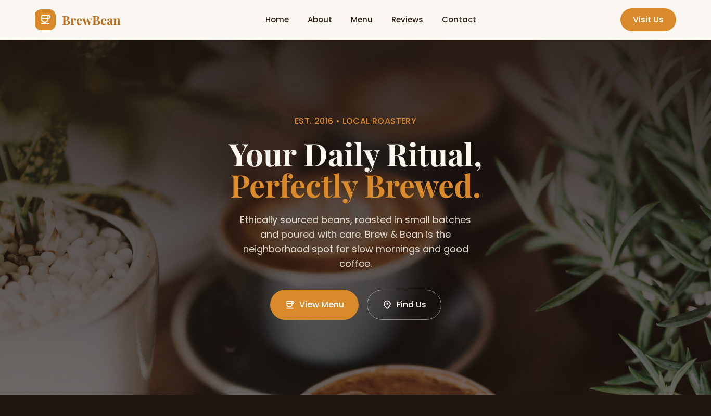

# BrewBean — Coffee Roastery Website

Responsive local coffee roastery website built with Tailwind CSS.

**Live demo:** https://ammad-codes.github.io/Tailwind-css-responsive-website-brew-beans/

## Tech used
HTML5, Tailwind CSS

## Features
- Hero with menu and location buttons
- About, menu and customer reviews sections
- Custom colour theme
- Responsive on all screen sizes

## Author
Ammad Khan — Frontend Developer (HTML, CSS, Tailwind) · https://github.com/ammad-codes
